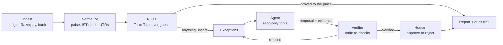

# Ziro — every paisa, accounted for

**The problem.** A merchant's ledger, Razorpay and the bank statement never agree one to one. Fees and GST are netted, one payout covers many payments, refunds and chargebacks are subtracted, and reference numbers get garbled. Finance teams close the month by hand in Excel, and money that went wrong (a fee overcharge, a late payout) goes unnoticed.

**What Ziro does.** Code matches everything it can prove, to the paise. An AI agent investigates only what is left. Code re-checks every claim the agent makes, and a person approves before anything is booked. Every step is written to an audit log, and every number below is measured against known answers.

- **Live demo:** _[add the Cloud Run URL after deploying]_. No login. Click **Run demo batch (50 orders)**, or **Replay eval run**, a precomputed 500-order run that costs nothing and needs no API key.
- **2-minute video:** _[add the link]_
- **GIF:** _[add docs/media/demo.gif]_

The demo's free agent is a scripted baseline, not a language model. Two of its proposals in every run are planted wrong answers, to show the checker refusing them. They are labelled wherever they appear.

## Results

Measured on synthetic orders whose right answers are known, so a match is either correct or it is not.

<!-- RESULTS:START -->

|                                      | Rules only                             | Rules + small model | Rules + large model |
| ------------------------------------ | -------------------------------------- | ------------------- | ------------------- |
| Match rate (groups found exactly)    | 97.4%                                  | not run yet         | not run yet         |
| False matches (wrong links accepted) | 0                                      | not run yet         | not run yet         |
| Proposals the verifier refused       | no agent                               | not run yet         | not run yet         |
| Ziro gap (₹ still unexplained)       | ₹2,04,190.89                           | not run yet         | not run yet         |
| Cost per 1,000 orders                | $0                                     | not run yet         | not run yet         |
| Time                                 | 2.0 s (1.7 s–2.3 s) for all 500 orders | not run yet         | not run yet         |

_500 synthetic orders (eval dataset, seed 42), 534 true groups. Configured models: small claude-haiku-5-5, large claude-sonnet-5-5. Model columns show the mean (min–max) over the repeats. Rebuilt from `packages/evals/results/` by `npm run eval:report`; the full tables are in [EVALS.md](EVALS.md)._
<!-- RESULTS:END -->

How to read it:

- **False matches** is the row to read first. A wrong match books money against the wrong thing, which is worse than a match that was missed.
- **Ziro gap** is the money still tied up in open exceptions: what nobody has yet explained. Only the rules, plus agent matches a person approved, can shrink it.
- **"Not run yet"** means exactly that. No language model has been run against this set, so nothing in the model columns is an estimate. They fill in when `npm run eval` is run with a model configuration, which needs `--confirm` and a spending cap.
- The data is synthetic. See [Limitations](#limitations).

## How it works



- **Rules** match a ledger entry to a payment on receipt and amount, a settlement to its payments less fees, GST and refunds, and a settlement to a bank line by UTR and amount. A fourth rule matches on amount alone, within a date window, when exactly one candidate fits. Amounts must agree exactly; only dates have a tolerance. If two candidates fit, the record becomes an exception.
- **The agent** gets one exception at a time and nine read-only tools. It must cite which tool call supports each claim.
- **The verifier** recomputes the paise, the record ids and the date windows from the database. It can refuse the agent, and does.
- **The report** shows the unexplained amount, fee leakage against the fee contract, delayed settlements, and journal entries as CSV for Tally.

More: [ARCHITECTURE.md](docs/ARCHITECTURE.md) has the components, the data model, the life of one exception and the failure modes.

## Safety model

- **The agent proposes, code verifies, humans approve.** The model never writes a match.
- **Money is integer paise,** never a float. Rounding is explicit, half-up, and tested.
- **The agent's tools are read-only** and limited to the run being investigated.
- **Text from outside is untrusted.** Ledger memos and bank narrations reach the model inside `<untrusted>` tags and appear in the console as plain text.
- **Razorpay test mode only.** The app refuses to boot with a live key. No real customer data is used.

These are enforced in code and covered by tests, not requested in a prompt.

## What I built first, and what I cut

The rule used: build first whatever makes a number more correct or a claim more checkable. Cut whatever only makes the product look finished.

**Built first, in this order:** integer-paise money; synthetic data with an answer key; strict ingestion; the rule matcher; the agent with read-only tools; the verifier, review queue and audit log; the console and free demo; the report; the evals; failure handling and deployment.

**Cut on purpose:**

- Accounts and tenancy: a core-logic exercise with a public demo does not need them.
- Live Razorpay settlements and bank feeds: test mode appears to have no settlements.
- Other currencies and the CGST/SGST/IGST split: the inputs do not carry what they need.
- Auto-accepting agent matches in the public demo: a demo should show a person deciding.
- Posting into Tally or a bank: export only.
- Fine-tuning, embeddings, scheduling, interface polish.

The full MoSCoW table, with a line of reasoning for each row, is in [PRIORITIES.md](docs/PRIORITIES.md). The reasons behind each design choice are in [DECISIONS.md](docs/DECISIONS.md).

## Run it

**With Docker** (needs Docker and bash; on Windows use Git Bash or WSL):

```bash
git clone <this repository> ziro && cd ziro
scripts/docker-local.sh up
# open http://127.0.0.1:8080
```

The first run builds the image, migrates the database, builds the 500-order replay and starts the service. No API key is passed in, and the replay and the 50-order run both work without one.

**For development** (Node 24):

```bash
npm ci
docker compose up -d --wait
npm run db:migrate && npm run dev     # console at http://localhost:5173
```

**Run the evals** in one command. The rules run is free:

```bash
npm run eval -- --configs rules
```

It scores the rules against the answer key three times, checks they give identical results, and writes the files under `packages/evals/results/`. The first run also times the rules on a 100,000-row set, which it generates (about 15 seconds, git-ignored); add `--stress false` to skip that. `npm run eval:report` then rebuilds [EVALS.md](EVALS.md) and the table above from those files, also free. Anything that calls a model does nothing until you pass `--confirm` and `--max-cost-usd`.

To put it on Google Cloud, Neon and Upstash: [docs/DEPLOY.md](docs/DEPLOY.md).

## Limitations

- **The data is synthetic.** Payments can come from Razorpay test mode (that code is tested against the documented response shapes, not recorded from a live account), but test mode appears to have no settlements, so settlements, the recon report and bank lines are generated. How well this does on a real merchant's files is not known.
- **No language model has been measured.** The agent, its checks and its failure handling are built and tested, but the model columns are empty until a paid run is approved. Costs and accuracy are not claimed.
- **The Tally export has never been imported into Tally.** The format follows Tally's documentation. There is one GST ledger, with no CGST/SGST/IGST split.
- **INR only.** The verifier refuses any other currency.
- **UTR formats** were checked against the generator and one real bank statement. Other banks' narrations may hide references the extractor does not recognise.
- **Fee rounding at exact half-paise ties** is an assumption; Razorpay's behaviour there is undocumented.
- **No accounts.** The reviewer's name is typed text. On the public demo, visitors can only start a run, review in their own run, and reset it.
- **Limits are held in one process,** so the deployment runs a single instance. Runs are archived, never deleted, so storage grows.
- **The deployment has been rehearsed locally,** against the same database and Redis, as the same container. It has not been run on real Google Cloud, Neon or Upstash accounts.
- **Some parts have not been run for real:** the second harness (the Claude Agent SDK) and the console in a browser by a person.

## Prior art

My earlier project, ReconLite (an in-browser two-file matcher), informed the matcher design. Ziro is a fresh implementation built for this challenge: no code was carried over, only ideas.

## Documents

[ARCHITECTURE.md](docs/ARCHITECTURE.md) · [DECISIONS.md](docs/DECISIONS.md) · [PRIORITIES.md](docs/PRIORITIES.md) · [DEPLOY.md](docs/DEPLOY.md) · [EVALS.md](EVALS.md) · [CLAUDE.md](CLAUDE.md) (the project brief and progress log)
