# Architecture

> Stub. Filled in as each module lands. The product brief and non-negotiables live in
> [`CLAUDE.md`](../CLAUDE.md); decisions live in [`DECISIONS.md`](./DECISIONS.md).

## Pipeline

1. **Ingest:** ledger CSV, Razorpay data (test mode or synthetic), bank CSV.
2. **Normalize:** integer paise, IST business dates, UTR extraction, cleaned refs.
3. **Rule matcher:** deterministic waterfall (T1–T4).
4. **Exceptions:** what rules could not match safely, with candidate ids.
5. **Agent:** read-only investigation, returns a proposal with evidence.
6. **Verifier:** code re-checks paise, ids and windows; it can reject the agent.
7. **Human review:** approve or reject; auto-accept only under strict limits.
8. **Report:** match rate, open exceptions, ₹ unreconciled, fee leakage, journal entries, audit.

## Layout

| Path               | Package         | Responsibility                                                |
| ------------------ | --------------- | ------------------------------------------------------------- |
| `packages/core`    | `@ziro/core`    | Pure TS, no IO: money, domain, normalize, matcher, verifier.  |
| `packages/datagen` | `@ziro/datagen` | Seeded synthetic data plus ground truth.                      |
| `packages/evals`   | `@ziro/evals`   | Eval runner, metrics, `EVALS.md` writer.                      |
| `apps/api`         | `@ziro/api`     | NestJS: config, ingest, recon, agent, verify, review, report. |
| `apps/web`         | `@ziro/web`     | Minimal review console; built and served by the API in prod.  |

Dependency direction: `apps/*` → `evals` → `datagen` → `core`. `core` imports nothing from the
workspace and nothing with IO (enforced by ESLint, see ADR-001).

## Runtime (dev)

`docker compose up -d` provides Postgres 16 (host port **5433**, so a native Postgres on 5432 does
not collide) and Redis 7. `npm run dev` builds the libraries, then runs `tsc -b --watch` (libs),
`nest start --watch` (API, port 3000) and Vite (web, port 5173, which proxies `/health` to the API).
`npm run db:migrate` applies the Drizzle migrations to the compose database.

## Configuration

Every environment variable is validated by a zod schema (`apps/api/src/config/env.ts`) before Nest
starts; boot fails with the full list of problems. A `RAZORPAY_KEY_ID` starting with `rzp_live_` is
always rejected. See `.env.example`.

## Money

Money is integer paise end to end: a branded `bigint` in TypeScript (`@ziro/core/money`), `bigint`
columns in Postgres, and integer strings in JSON (JSON cannot carry a bigint). `parseRupees` accepts
only plain digits or strict Indian grouping (`1,23,456.50`) and never rounds; `percentOfHalfUp`
rounds exact ties up, in pure bigint arithmetic. ESLint bans `Math.*`, `Number()`, `parseFloat`,
`.toFixed` and decimal literals under `packages/core/src/money`. Razorpay's `fee` already includes
GST (`tax` is the GST part of it), see ADR-004.

## Data model

Every ingested source record carries `run_id`, `source`, `source_ref`, `import_hash` (plus `raw` and
`created_at`). `(run_id, source_ref)` is the identity; `import_hash` is deliberately not unique,
because two identical bank lines are legitimate. Razorpay's own ids live in `rzp_*` text columns and
`<table>_id` columns are uuid foreign keys. There are no cascading deletes: runs are archived, never
deleted. Free text (`memo`, `narration`, `description`, `raw`, an agent's `explanation`) is untrusted.

```mermaid
erDiagram
    recon_runs ||--o{ ledger_entries : "run_id"
    recon_runs ||--o{ rzp_payments : "run_id"
    recon_runs ||--o{ rzp_refunds : "run_id"
    recon_runs ||--o{ rzp_settlements : "run_id"
    recon_runs ||--o{ settlement_items : "run_id"
    recon_runs ||--o{ bank_lines : "run_id"
    recon_runs ||--o{ match_groups : "run_id"
    recon_runs ||--o{ recon_exceptions : "run_id"
    recon_runs ||--o{ agent_proposals : "run_id"
    recon_runs ||--o{ reviews : "run_id"
    recon_runs ||--o{ llm_calls : "run_id"
    recon_runs |o--o{ audit_events : "run_id"

    rzp_settlements ||--o{ settlement_items : "settlement_id"
    rzp_payments |o--o{ rzp_refunds : "payment_id"
    rzp_payments |o--o{ settlement_items : "payment_id"
    rzp_refunds |o--o{ settlement_items : "refund_id"

    match_groups ||--o{ match_links : "group_id + group_status"
    ledger_entries |o--o{ match_links : "ledger_entry_id"
    rzp_payments |o--o{ match_links : "payment_id"
    rzp_refunds |o--o{ match_links : "refund_id"
    rzp_settlements |o--o{ match_links : "settlement_id"
    bank_lines |o--o{ match_links : "bank_line_id"

    recon_exceptions ||--o{ agent_proposals : "exception_id"
    recon_exceptions |o--o{ llm_calls : "exception_id"
    llm_calls |o--o{ agent_proposals : "llm_call_id"
    agent_proposals ||--o| reviews : "proposal_id"

    recon_runs {
        uuid id PK
        run_status status
        razorpay_source razorpay_source
        date period_start
        date period_end
        jsonb config
    }
    ledger_entries {
        uuid id PK
        uuid run_id FK
        text source_ref UK "unique with run_id"
        char import_hash "sha-256 hex, not unique"
        text order_ref
        bigint amount_paise
        date business_date
        text memo "untrusted"
    }
    rzp_payments {
        uuid id PK
        uuid run_id FK
        text rzp_id UK "pay_..., unique with run_id"
        text rzp_order_id
        text receipt "equals ledger order_ref"
        bigint amount_paise
        bigint fee_paise "GST inclusive"
        bigint tax_paise "GST part of fee"
        bigint amount_refunded_paise
    }
    rzp_refunds {
        uuid id PK
        uuid run_id FK
        text rzp_id UK "rfnd_..."
        text rzp_payment_id "always known"
        uuid payment_id FK "null if payment not in run"
        bigint amount_paise
    }
    rzp_settlements {
        uuid id PK
        uuid run_id FK
        text rzp_id UK "setl_..."
        bigint amount_paise "net payout"
        bigint fees_paise "informational"
        text utr
    }
    settlement_items {
        uuid id PK
        uuid run_id FK
        uuid settlement_id FK
        settlement_item_type item_type "payment refund transfer adjustment"
        uuid payment_id FK
        uuid refund_id FK
        bigint amount_paise
        bigint fee_paise
        bigint tax_paise
        bigint debit_paise
        bigint credit_paise
    }
    bank_lines {
        uuid id PK
        uuid run_id FK
        date value_date
        bank_direction direction
        bigint amount_paise
        text narration "untrusted"
        text utr "extracted"
        utr_quality utr_quality "exact rejoined repaired truncated"
    }
    match_groups {
        uuid id PK
        uuid run_id FK
        match_group_kind kind "order or payout"
        match_group_status status "unique with id"
        match_basis basis "rule agent human"
        match_tier tier "T1 to T4, set for rule matches"
        text rule_id "set for rule matches"
        reason_code reason_code
        bigint residual_paise "must be 0 when accepted"
    }
    match_links {
        uuid id PK
        uuid group_id FK
        match_group_status group_status FK "mirrors group status"
        uuid ledger_entry_id FK "exactly one of five"
        uuid payment_id FK
        uuid refund_id FK
        uuid settlement_id FK
        uuid bank_line_id FK
    }
    recon_exceptions {
        uuid id PK
        uuid run_id FK
        reason_code reason_code
        exception_status status
        record_type subject_type "polymorphic, no FK"
        uuid subject_id "unique per run"
        bigint amount_at_stake_paise
    }
    llm_calls {
        uuid id PK
        uuid run_id FK
        uuid exception_id FK
        text model
        harness harness
        int tokens_in
        int tokens_out
        numeric cost_usd "USD spend, not merchant money"
        char prompt_hash
    }
    agent_proposals {
        uuid id PK
        uuid run_id FK
        uuid exception_id FK
        uuid llm_call_id FK
        reason_code reason_code
        bigint claimed_residual_paise "a claim, never trusted"
        verifier_status verifier_status
    }
    reviews {
        uuid id PK
        uuid run_id FK
        uuid proposal_id FK "unique: one decision per proposal"
        review_decision decision
        reviewer_kind reviewer_kind "human or auto_accept"
    }
    audit_events {
        bigint id PK "identity, strictly ordered"
        uuid run_id FK
        actor actor "rule agent verifier human system"
        text action
        text entity_type
        text entity_id
        jsonb detail
    }
```



Invariants the database enforces (details in ADR-005):

- **A record sits in at most one accepted match group.** `match_links` mirrors the group's status via
  the composite foreign key `(group_id, group_status)`, and a partial unique index per record type
  (`WHERE group_status = 'accepted'`) does the rest. Exactly one record column is set per link.
- **An accepted group reconciles exactly:** `residual_paise = 0`.
- **`audit_events` is append-only.** Triggers reject `UPDATE`, `DELETE` and `TRUNCATE`.
- Money columns are `bigint` and non-negative where a negative makes no sense; `import_hash` and
  `prompt_hash` must be lowercase sha-256 hex; enum columns mirror the lists in `@ziro/core/domain`.

## Synthetic data and ground truth

`@ziro/datagen` generates seeded, byte-identical datasets (`demo` 50 orders, `eval` 500, `stress`
~100k ledger rows and ~100k bank lines): a ledger CSV, Razorpay-shaped orders, payments, refunds,
settlements and settlement recon, a bank statement, and `truth.json`, which says how every record
relates to every other and why they differ. Eleven anomaly types are injected at configurable,
exact-count rates, plus labelled prompt-injection strings. Every published metric is measured against
`truth.json`. See [`packages/datagen/README.md`](../packages/datagen/README.md) for the rate table,
file formats, truth schema and assumptions, and ADR-007 for the truth semantics.

## Razorpay source layer

`apps/api/src/razorpay` is the one door through which Razorpay data enters Ziro (ADR-008):

```
RazorpaySource ── SyntheticSource ── reads a datagen directory ─────────┐
   (4 calls)   └─ TestModeSource ── official SDK, TEST keys only ──┐    │   raw JSON
                                    sdk-client.ts (timeout, retry,  │    │
                                    network-failure fix, paging)    ▼    ▼
                                                                  mappers.ts ──▶ @ziro/core domain records
```

Every record and result carries `source: synthetic | razorpay_testmode`. Test mode supplies payments,
orders and refunds you created with the test keys; it appears to have no settlements, so those and the
recon report fall back to synthetic, per entity and only on an _empty_ answer (never on an error). A
run that draws on both is `mixed`: honest, but its records will not reconcile with each other, so it
is never used for a published number. Time conversion (Unix seconds → IST business date) is
`@ziro/core/time`.

## Ingestion

`@ziro/core/normalize` holds the pure transforms; `apps/api/src/ingest` is the thin, transactional
shell around them (ADR-009).

```
upload ─▶ decode (strict UTF-8) ─▶ parseCsv ─▶ per-row zod ─▶ rows + errors[] ─┐   pure, no IO
                                                                                 │
                    classify against the DB (new / unchanged / conflict) ◀───────┘
                    INSERT … ON CONFLICT (run_id, source_ref) DO NOTHING          ┐ ONE transaction:
                    audit_events row (+ run.status_changed on the first import)   ┘ data + audit together
```

| Endpoint                         | What it does                                                                                              |
| -------------------------------- | --------------------------------------------------------------------------------------------------------- |
| `POST /runs`                     | New run. The Razorpay source is stamped from server config, never from the request.                       |
| `POST /runs/:id/import/ledger`   | Multipart `file` (CSV). 200 + report; 422 + the same report if the file is unusable.                      |
| `POST /runs/:id/import/bank`     | Same, for the bank statement.                                                                             |
| `POST /runs/:id/import/razorpay` | `{from, to}` (≤ 93 days) through the selected `RazorpaySource`; settlements/recon look 7 days further on. |
| `POST /runs/demo`                | New run + the demo preset, one transaction, always the synthetic source.                                  |
| `GET /runs/:id`                  | The run and its record counts per table and per `source`.                                                 |

**Row identity.** A ledger row's identity is its normalized `order_ref`; a bank line's is its position
(`row-<n>`, the key `truth.json` uses), because two identical statement lines are legitimate. Ids are
`deterministicUuid(run, type, source_ref)` and `import_hash` is the sha-256 of the row's cells as
received, so the same file always produces the same ids and hashes. Existing rows are immutable:
identical content is `unchanged`, different content is a reported `conflict`, never an overwrite.

**Report.** `status` is `ok`, `partial` (some rows rejected or conflicting) or `rejected` (file
unusable, nothing written). Each problem is `{row, line, field, code, reason}`; `row` is the 1-based
data row, `line` the physical line. Control totals (Σ ledger, Σ credits, Σ debits, in paise) let the
merchant check the import against their own books, and a bank statement whose running balance does not
chain gets a warning on the row where it breaks.

**UTR quality.** `bank_lines.utr` is only as trustworthy as `utr_quality`: `exact`, `rejoined` (a split
UTR joined back), `repaired` (look-alike characters fixed: O/0, I/1, S/5, B/8, only when one reading is
cheapest) or `truncated` (a fragment, never equal to a full UTR). Measured against datagen's ground
truth the extractor makes no wrong repairs; a garble that keeps the token well-formed (two digits
swapped) is invisible to it and surfaces later as a UTR mismatch.

## Rule matcher

`@ziro/core/matcher` is a pure function, `runMatcher(input, config)`, over domain records (ADR-010). It
never breaks a tie, so its output does not depend on input order, and every input record ends in
exactly one place: a group, an exception, or the ignored list.

```
ledger ──T1 receipt + amount──▶ payment (+ its refunds)                      = order group
settlement ──T2 composition──▶ verified? ──T3 UTR + amount──▶ bank credit    = payout group
                                         └─T4 amount, window, unique──▶       (tier T3 or T4)
```

| Tier | Rule (id)                                  | Matches when                                                                                              |
| ---- | ------------------------------------------ | --------------------------------------------------------------------------------------------------------- |
| T1   | `T1.receipt-amount.v1`                     | one ledger entry and one captured payment share a cleaned receipt, and the amounts are equal              |
| T2   | `T2.settlement-composition.v1` (a verdict) | `settlement = Σ payments − Σ fees − Σ refunds ± adjustments`, exactly, and no line contradicts its record |
| T3   | `T3.utr-amount.v1`                         | a verified settlement and one credit carry the same exact or re-joined UTR, and the amounts are equal     |
| T4   | `T4.amount-window-unique.v1`               | amount equal, value date in [settlement date, +3 business days], and exactly one candidate on both sides  |

The settlement maths lives in ONE function, `composeSettlement`, which the verifier will call too. The
fee already contains its GST (ADR-004), so tax is reported but never subtracted a second time. T2 is a
verdict rather than a group because a payment already sits in an order group (ADR-005); a settlement
that does not add up never reaches T3 or T4.

Anything the rules cannot settle safely becomes an exception with its candidates attached (at most 50,
and how many there were). Rules set a reason code only from structure: no payment of any status for a
reference (`LEDGER_WITHOUT_PAYMENT`), a captured payment no ledger entry claims
(`PAYMENT_WITHOUT_LEDGER`), a retry receipt of an order already matched at the same amount
(`DUPLICATE_PAYMENT`), a damaged UTR among ambiguous candidates (`UTR_MISSING_OR_GARBLED`), a single
credit just past the window (`SETTLEMENT_DELAYED`). Matched groups can carry an explanation:
`FULL_REFUND` or `PARTIAL_REFUND_NETTED`, `TIMEZONE_DATE_SHIFT`, `CHARGEBACK_ADJUSTMENT`,
`SETTLEMENT_DELAYED`. Everything else, notably `LEDGER_AMOUNT_EDITED` and `FEE_OVERCHARGE`, is `UNKNOWN`
or left to the agent and the leakage report.

Measured on the eval preset (500 orders, seed 42, against `truth.json`): 472 of 485 order groups
exactly and 3 partially (a duplicate payment and its refund cannot be linked by rules), 48 of 49 payout
groups, and **0 wrong links, 0 lost records, 0 wrong labels**. Every injected duplicate, edited
ledger, cash order and manual payment was raised for the agent. `npm run bench:matcher` times the
matcher alone on the stress preset: 410,214 input rows in about 2.1 s (157,000 to 195,000 rows/sec
over two runs), with the files loaded beforehand.

## Investigation agent

`apps/api/src/agent` investigates the exceptions the rules left (ADR-011). It proposes; it never matches.
Nothing it says is stored until the harness has checked it against what the tools actually returned.

```
POST /runs/:id/investigate ──▶ plan: open exceptions ─ triage ─ cluster? ─▶ jobs (exception, attempt)
                                                                              │ BullMQ, concurrency-limited
                                                                              ▼
 gate (kill switch, day's spend) ─▶ LoopRunner ─▶ small model ─┐
                                      │   ▲ tool results       │ unsure / NEEDS_HUMAN?
                                      ▼   │                    ▼
                          9 read-only tools (READ ONLY tx)   large model, fresh conversation
                                                                              │
                  finalize: ground evidence + links, downgrade, balance journal ◀┘
                                                                              ▼
              agent_proposals (unique exception+attempt) + exception → proposed + audit_events + llm_calls
```

**Tools.** `get_exception`, `get_ledger_entry`, `search_ledger`, `get_payment`, `list_refunds`,
`get_settlement_composition`, `search_bank_lines`, `compute_expected_settlement`, `get_fee_contract`.
Arguments are validated by strict zod schemas (unknown keys refused, so a model cannot name a run), each
call is a `READ ONLY` transaction with a 5 s statement timeout, and a result is capped at 12,000
characters. Searches need at least one filter, cap rows at 20 and date spans at 62 days. The two
settlement tools run the same `composeLines` as rule tier T2, so "does this add up?" has one answer.

**Where the model's output is distrusted.**

| Layer                 | What it stops                                                                                 |
| --------------------- | --------------------------------------------------------------------------------------------- |
| `<untrusted>` wrapper | Memo, narration, customer reference, line description and odd references are data only.       |
| Strict output schema  | Unknown keys (an `approve` field), more than three sentences, confidence outside 0 to 1.      |
| Call-number evidence  | The model cites `{call, keyFinding}`; the harness writes tool and arguments from its own log. |
| Link grounding        | A match naming a record no tool returned is downgraded to NEEDS_HUMAN, not trimmed.           |
| Action rules          | `ACCEPT_MATCH` only for a proposed match at 0.5 or more; journal entries must balance.        |
| Budgets               | 8 tool calls, 24k output tokens, 60 s (request aborted), prompt ceiling; then NEEDS_HUMAN.    |
| Verifier (next task)  | Re-checks the paise, ids and windows; a person approves above the thresholds.                 |

**Execution.** A job is `(exception, attempt)` pairs and carries no record data. The unique index on
`agent_proposals(exception_id, attempt)` makes a repeated or racing job store one proposal; `process`
also skips work already on record before it spends anything. Every request is written to `llm_calls` as
it happens, including prompt-cache reads and writes, so spend is recorded even when the investigation
later fails. A halt (kill switch, daily budget) ends the job and leaves the exceptions open.

**Configuration** (all in `.env.example`): `ANTHROPIC_API_KEY` (optional at boot; without it the
endpoint answers 503 and no worker starts), `AGENT_MODEL_SMALL`, `AGENT_MODEL_LARGE` (must be in
`agent/pricing.ts`, or boot fails), `AGENT_HARNESS=loop`, `AGENT_ESCALATION`, `CLUSTER_EXCEPTIONS`,
`AGENT_CONCURRENCY`, `AGENT_WORKER_ENABLED`, `AGENT_KILL_SWITCH`, `DAILY_LLM_BUDGET_USD`.

## Verifier, policy and review

A stored agent proposal is a claim. `@ziro/core/verify` re-derives it from the records, `apps/api/src/review`
routes it, and nothing becomes a match without passing both (ADR-012).

```
agent proposal ──▶ verifyProposal ──REJECTED──▶ exception back to open, counted "caught by the verifier"
 (stored, pending)     │
                       └─VERIFIED──▶ decideRoute ──auto_accept (every condition)──┐
                                          └──human──▶ review queue ──approve──────┴▶ writeGroup
                                                          └──reject (note)──▶ exception open     (accepted group,
                                                                                                  links, audit)
```

| Check                         | Order group (ledger + payments + refunds)                         | Payout group (settlement + bank credit)                    |
| ----------------------------- | ----------------------------------------------------------------- | ---------------------------------------------------------- |
| Records exist, this run, free | each id found, `runId` equal, not in an accepted group            | the same                                                   |
| Money, to the paise           | `Σ ledger = Σ captured payments − Σ processed refunds`            | `composeSettlement` reconciles, and credit = settlement    |
| Nothing hidden                | every refund a payment records is linked                          | every line agrees with its payment or refund record        |
| Dates, from the run's windows | ledger and payment within `orderDateWindowDays`; refund after pay | credit in [settlement date, +T4 window], or late and said  |
| Currency                      | payments and refunds in INR                                       | settlement lines in INR                                    |
| Reason code fits the links    | refund, duplicate and date-shift codes need what they claim       | batch, fee, chargeback, delay and UTR codes likewise       |
| UTRs                          | n/a                                                               | two trusted UTRs may not differ (unless the claim says so) |

**Policy.** Auto-accept needs all of: verified, the agent suggested accepting, gross within
`AUTO_ACCEPT_MAX_PAISE`, confidence at least `AUTO_ACCEPT_MIN_CONFIDENCE` (0.85), `AUTO_ACCEPT_ENABLED`, and
neither `DEMO_MODE` nor `AGENT_KILL_SWITCH`. Otherwise the proposal goes to the queue with every reason it
needed a person.

**Review API.**

| Endpoint                       | Does                                                                           |
| ------------------------------ | ------------------------------------------------------------------------------ |
| `GET /runs/:id/review/queue`   | proposals awaiting a person, largest amount at stake first (`limit`, `offset`) |
| `GET /runs/:id/review/summary` | counts, `caughtByVerifier`, rejection reasons, queue size, reviews             |
| `POST /runs/:id/verify`        | verifies proposals that were stored but not yet verified                       |
| `GET /proposals/:id`           | proposal, evidence, findings, exception, decision                              |
| `POST /proposals/:id/approve`  | re-verifies, writes the group, resolves the exceptions; `409` if stale         |
| `POST /proposals/:id/reject`   | needs a note; the exception returns to `open`                                  |
| `GET /records/:id/audit`       | the timeline of any source record, from its import to its group                |

**Audit.** `auditStep` writes `{ before, after, reason, records }` and indexes each record in
`audit_event_records`, so a record's timeline is one indexed lookup; its import is read from the record
itself. Both tables are append-only. A record's story on the end-to-end test reads
`record.imported, agent.propose, verifier.verified, policy.human_review, group.create, exception.resolve,
review.approve`.

**Not yet:** the endpoints are unauthenticated (`reviewer` is a recorded name, not an identity), and
nothing persists the rules' own groups, so on real data there are no exceptions to propose about until P7.

## Console and demo

```
browser ──hash routes──▶ apps/web (React, one CSS file)
   │  GET /demo · POST /demo/runs · GET /runs/:id/progress
   │  GET /runs/:id/overview · /exceptions · /records · GET /exceptions/:id
   │  POST /proposals/:id/approve|reject · GET /records/:id/audit
   │  GET /runs/:id/{report.json,report.csv,exceptions.csv,journal-entries.csv}
   ▼
apps/api  (serves the built web files; CSP; trust proxy 1)
   demo/    DemoService: generate seeded data in-process → ingest → ReconService.match
            → AgentService (ScriptedRunner by default) → verifier → review queue
   recon/   ReconService: runMatcher output → match_groups / links / recon_exceptions + audit
   report/  ReportService (reads only) · DownloadService · gap.ts · csv.ts
```

- **Progress** is derived from table counts, not stored separately, so it cannot disagree with the data.
- **Featured runs** (demo and eval presets) are seeded at boot when missing (`DEMO_SEED_ON_BOOT`), tagged in
  `reconRuns.config.featured` with a version; bump `FEATURED_VERSION` when the pipeline changes.
- **Gap** (`report/gap.ts`): union-find over exceptions that share records; one case counts once at its
  largest stake; see ADR-013.
- **CSV** (`report/csv.ts`): text cells that begin with `= + - @ \t \r` are prefixed with `'`; numbers are
  never touched.

## Run report and books

```
ReportService.overview(run)
  partition()        per source: records and paise matched / in an exception / ignored (independent counts)
  exceptionFacts()   stake, records touched, subject date -> age against run.periodEnd -> casesOf() -> age buckets
  resolution()       who settled what (rules, agent + person, auto-accept, rejected, waiting)
  leakage()          auditFees(captured payments, run feeContract)            report/leakage.ts
  settlementFacts()  findDelays(settlements, matcher windows, asOf)           report/delays.ts
  vouchers()         accepted payout groups -> composeLines -> settlementVouchers   report/tally.ts
                     + person-approved agent drafts -> adjustmentVoucher
DownloadService      report.json/.csv, exceptions.csv (next_step), journal-entries.csv, journal-lines.csv
```

- `leakage.ts`, `delays.ts`, `tally.ts`, `next-step.ts` and `gap.ts` are pure (no database, no clock); the
  service only loads rows and calls them.
- One arithmetic for settlements: vouchers use `composeLines`, the same function tier T2 and the verifier
  use, and one chargeback test, `isChargebackLine`, shared with the rule label.
- Format and assumptions for the Tally files: ADR-014.

## Evals

```
npm run eval            apps/api/src/eval/cli.ts          (paid when a model config is named; needs --confirm and --max-cost-usd)
   args.ts              what was asked, and the rules about what may spend money
   overlay.ts           injection payloads on a COPY of the dataset; each placement checked against the rules
   pipeline.ts          one run: fresh PGlite -> ingest -> match -> agent -> verifier -> simulated reviewer -> score
   measuring.ts         wraps any AgentRunner: timing, tools, observed exposure, the cost cap
   runners.ts           small / large (harness A), harnessB (agent/sdk-runner.ts)
   collect.ts           reads a finished run back as truth keys
   stress.ts            rules throughput, no database, no model
        |  scores with
        v
packages/evals/src      truth.ts  score.ts  stats.ts  injection.ts  results.ts  results-io.ts  report.ts
        |  writes / reads
        v
packages/evals/results/<preset>-<seed>/<config>[+cluster]-<leg>.json
        |  npm run eval:report (free)
        v
EVALS.md                tables, "what the numbers show", limits, and the author's Opinion block
```

- The dependency runs api → evals → core, so the pure parts are unit-tested without a database.
- `agent/sdk-runner.ts` is a real harness (`AGENT_HARNESS=agent-sdk`), not only an eval fixture.
- Definitions, the simulated reviewer, the injection overlay and the limits of the evidence: ADR-015.

## TODO

- Persist the rule matcher's groups and exceptions (P7) through `writeGroup`.
- Harness B (the Claude Agent SDK) behind the same `AgentRunner` interface.
- Deployment topology (Cloud Run, Neon, Upstash).
