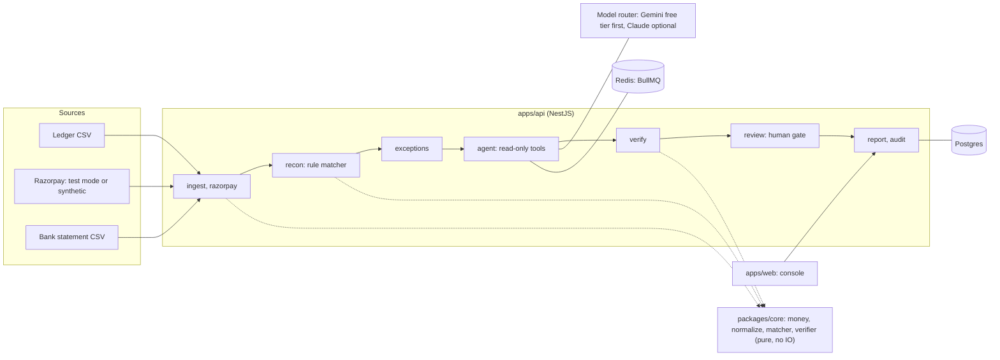

# Architecture

> How Ziro is put together. The product brief and non-negotiables are in [`CLAUDE.md`](../CLAUDE.md), the
> reasons for each choice in [`DECISIONS.md`](./DECISIONS.md), what was built and cut in
> [`PRIORITIES.md`](./PRIORITIES.md), and how to deploy it in [`DEPLOY.md`](./DEPLOY.md).

Contents: [Pipeline](#pipeline) · [Components](#components) · [Life of one exception](#life-of-one-exception) ·
[Layout](#layout) · [Data model](#data-model) · [Failure modes](#failure-modes) · [Deployment](#deployment)

## Pipeline

1. **Ingest:** ledger CSV, Razorpay data (test mode or synthetic), bank CSV.
2. **Normalize:** integer paise, IST business dates, UTR extraction, cleaned refs.
3. **Rule matcher:** deterministic waterfall (T1–T4).
4. **Exceptions:** what rules could not match safely, with candidate ids.
5. **Agent:** read-only investigation, returns a proposal with evidence.
6. **Verifier:** code re-checks paise, ids and windows; it can reject the agent.
7. **Human review:** approve or reject; auto-accept only under strict limits.
8. **Report:** match rate, open exceptions, ₹ unreconciled, fee leakage, journal entries, audit.

## Components



Solid arrows are the data flow, dotted ones are "uses". Everything that decides a match or a total lives in
`packages/core` and is pure; the API wraps it with storage, HTTP and the model.

## Life of one exception

What happens to a single record the rules could not match, from the rule that raises it to the audit row
that closes it. Each step writes its own audit event.

```mermaid
sequenceDiagram
    autonumber
    participant M as Rule matcher
    participant DB as Database
    participant A as Agent harness
    participant T as Read-only tools
    participant R as Model router
    participant LLM as Model (Gemini or Claude)
    participant V as Verifier
    participant P as Policy
    participant H as Person

    M->>DB: no safe match, so write an exception with a reason code and candidate ids
    A->>DB: pick up the job for (exception, attempt)
    A->>T: get_exception (call 0, the brief)
    opt single-shot, the default: the harness gathers the evidence itself
        A->>T: fixed read-only lookups (ledger, payments, refunds, settlement, arithmetic, fee contract)
        T-->>A: results, with free text inside untrusted tags
    end
    loop one structured call; in the loop harness up to 4 tool calls, 24k output tokens, 60 seconds
        A->>R: the conversation so far, for ONE model
        R->>LLM: the request, after the cache and the request limits
        LLM-->>A: a final answer, or (loop only) a tool request
        A->>T: (loop only) run the tool, READ ONLY, scoped to this run
    end
    Note over R,LLM: a model that is out of quota, down or rate-limited is replaced by the next one, and the<br/>investigation restarts there from its first message: a conversation never mixes models
    A->>A: ground the answer, evidence by call number, links must have come from a tool
    alt every model failed, was refused, ran out of budget or answered invalidly
        A->>DB: store NEEDS_HUMAN with a degraded reason
    else a usable answer
        A->>DB: store the proposal (unique per exception and attempt)
    end
    DB->>V: re-derive the paise, the ids and the date windows from the records
    V->>DB: verified or rejected, with findings
    V->>P: a verified proposal
    P-->>H: wait in the review queue (auto-accept is off in the demo)
    H->>V: approve, and it is verified again against the data as it is now
    V->>DB: write the match group and resolve the exception
    Note over H,DB: a reject, or a stale proposal, sends the exception back to open
```

The model never writes a match. Everything after its answer is code, and the last step, which creates the match
group, is the same function the rules use.

## Layout

| Path               | Package         | Responsibility                                                          |
| ------------------ | --------------- | ----------------------------------------------------------------------- |
| `packages/core`    | `@ziro/core`    | Pure TS, no IO: money, domain, normalize, matcher, verifier, LLM types. |
| `packages/datagen` | `@ziro/datagen` | Seeded synthetic data plus ground truth.                                |
| `packages/evals`   | `@ziro/evals`   | Eval runner, metrics, `EVALS.md` writer.                                |
| `apps/api`         | `@ziro/api`     | NestJS: config, ingest, recon, agent, llm, verify, review, report.      |
| `apps/web`         | `@ziro/web`     | Minimal review console; built and served by the API in prod.            |
| `deploy/`          |                 | `demo.env`: the public demo's non-secret settings.                      |
| `scripts/`         |                 | Local Docker run, GCP setup, deploy, and the smoke test.                |

Dependency direction: `apps/*` → `evals` → `datagen` → `core`. `core` imports nothing from the
workspace and nothing with IO (enforced by ESLint, see ADR-001).

## Runtime (dev)

`docker compose up -d` provides Postgres 16 (host port **5433**, so a native Postgres on 5432 does
not collide) and Redis 7. `npm run dev` builds the libraries, then runs `tsc -b --watch` (libs),
`nest start --watch` (API, port 3000) and Vite (web, port 5173, which proxies `/health` to the API).
`npm run db:migrate` applies the Drizzle migrations to the compose database.

## Configuration

Every environment variable is validated by a zod schema (`apps/api/src/config/env.ts`) before Nest
starts; boot fails with the full list of problems. A `RAZORPAY_KEY_ID` starting with `rzp_live_` is
always rejected. See `.env.example`.

## Money

Money is integer paise end to end: a branded `bigint` in TypeScript (`@ziro/core/money`), `bigint`
columns in Postgres, and integer strings in JSON (JSON cannot carry a bigint). `parseRupees` accepts
only plain digits or strict Indian grouping (`1,23,456.50`) and never rounds; `percentOfHalfUp`
rounds exact ties up, in pure bigint arithmetic. ESLint bans `Math.*`, `Number()`, `parseFloat`,
`.toFixed` and decimal literals under `packages/core/src/money`. Razorpay's `fee` already includes
GST (`tax` is the GST part of it), see ADR-004.

## Data model

Every ingested source record carries `run_id`, `source`, `source_ref`, `import_hash` (plus `raw` and
`created_at`). `(run_id, source_ref)` is the identity; `import_hash` is deliberately not unique,
because two identical bank lines are legitimate. Razorpay's own ids live in `rzp_*` text columns and
`<table>_id` columns are uuid foreign keys. There are no cascading deletes: runs are archived, never
deleted. Free text (`memo`, `narration`, `description`, `raw`, an agent's `explanation`) is untrusted.

```mermaid
erDiagram
    recon_runs ||--o{ ledger_entries : "run_id"
    recon_runs ||--o{ rzp_payments : "run_id"
    recon_runs ||--o{ rzp_refunds : "run_id"
    recon_runs ||--o{ rzp_settlements : "run_id"
    recon_runs ||--o{ settlement_items : "run_id"
    recon_runs ||--o{ bank_lines : "run_id"
    recon_runs ||--o{ match_groups : "run_id"
    recon_runs ||--o{ recon_exceptions : "run_id"
    recon_runs ||--o{ agent_proposals : "run_id"
    recon_runs ||--o{ reviews : "run_id"
    recon_runs ||--o{ llm_calls : "run_id"
    recon_runs |o--o{ audit_events : "run_id"

    rzp_settlements ||--o{ settlement_items : "settlement_id"
    rzp_payments |o--o{ rzp_refunds : "payment_id"
    rzp_payments |o--o{ settlement_items : "payment_id"
    rzp_refunds |o--o{ settlement_items : "refund_id"

    match_groups ||--o{ match_links : "group_id + group_status"
    ledger_entries |o--o{ match_links : "ledger_entry_id"
    rzp_payments |o--o{ match_links : "payment_id"
    rzp_refunds |o--o{ match_links : "refund_id"
    rzp_settlements |o--o{ match_links : "settlement_id"
    bank_lines |o--o{ match_links : "bank_line_id"

    audit_events ||--o{ audit_event_records : "audit_event_id"
    recon_exceptions ||--o{ agent_proposals : "exception_id"
    recon_exceptions |o--o{ llm_calls : "exception_id"
    llm_calls |o--o{ agent_proposals : "llm_call_id"
    agent_proposals ||--o| reviews : "proposal_id"

    recon_runs {
        uuid id PK
        run_status status
        razorpay_source razorpay_source
        date period_start
        date period_end
        jsonb config
    }
    ledger_entries {
        uuid id PK
        uuid run_id FK
        text source_ref UK "unique with run_id"
        char import_hash "sha-256 hex, not unique"
        text order_ref
        bigint amount_paise
        date business_date
        text memo "untrusted"
    }
    rzp_payments {
        uuid id PK
        uuid run_id FK
        text rzp_id UK "pay_..., unique with run_id"
        text rzp_order_id
        text receipt "equals ledger order_ref"
        bigint amount_paise
        bigint fee_paise "GST inclusive"
        bigint tax_paise "GST part of fee"
        bigint amount_refunded_paise
    }
    rzp_refunds {
        uuid id PK
        uuid run_id FK
        text rzp_id UK "rfnd_..."
        text rzp_payment_id "always known"
        uuid payment_id FK "null if payment not in run"
        bigint amount_paise
    }
    rzp_settlements {
        uuid id PK
        uuid run_id FK
        text rzp_id UK "setl_..."
        bigint amount_paise "net payout"
        bigint fees_paise "informational"
        text utr
    }
    settlement_items {
        uuid id PK
        uuid run_id FK
        uuid settlement_id FK
        settlement_item_type item_type "payment refund transfer adjustment"
        uuid payment_id FK
        uuid refund_id FK
        bigint amount_paise
        bigint fee_paise
        bigint tax_paise
        bigint debit_paise
        bigint credit_paise
    }
    bank_lines {
        uuid id PK
        uuid run_id FK
        date value_date
        bank_direction direction
        bigint amount_paise
        text narration "untrusted"
        text utr "extracted"
        utr_quality utr_quality "exact rejoined repaired truncated"
    }
    match_groups {
        uuid id PK
        uuid run_id FK
        match_group_kind kind "order or payout"
        match_group_status status "unique with id"
        match_basis basis "rule agent human"
        match_tier tier "T1 to T4, set for rule matches"
        text rule_id "set for rule matches"
        reason_code reason_code
        bigint residual_paise "must be 0 when accepted"
    }
    match_links {
        uuid id PK
        uuid group_id FK
        match_group_status group_status FK "mirrors group status"
        uuid ledger_entry_id FK "exactly one of five"
        uuid payment_id FK
        uuid refund_id FK
        uuid settlement_id FK
        uuid bank_line_id FK
    }
    recon_exceptions {
        uuid id PK
        uuid run_id FK
        reason_code reason_code
        exception_status status
        record_type subject_type "polymorphic, no FK"
        uuid subject_id "unique per run"
        jsonb candidates "record ids the rules could not choose between"
        bigint amount_at_stake_paise
        text cause "why the rules stopped"
        text note
    }
    llm_calls {
        uuid id PK
        uuid run_id FK
        uuid exception_id FK
        text model
        harness harness
        int tokens_in
        int tokens_out
        numeric cost_usd "USD spend, not merchant money"
        char prompt_hash
    }
    agent_proposals {
        uuid id PK
        uuid run_id FK
        uuid exception_id FK
        uuid llm_call_id FK
        int attempt "unique with exception_id"
        agent_verdict verdict "match proposed, explained, needs a human"
        reason_code reason_code
        jsonb links "records the agent claims belong together"
        text explanation "untrusted"
        jsonb evidence "tool, arguments, finding"
        text degraded "why the system handed it to a person, or null"
        verifier_status verifier_status
    }
    reviews {
        uuid id PK
        uuid run_id FK
        uuid proposal_id FK "unique: one decision per proposal"
        review_decision decision
        reviewer_kind reviewer_kind "human or auto_accept"
    }
    audit_events {
        bigint id PK "identity, strictly ordered"
        uuid run_id FK
        actor actor "rule agent verifier human system"
        text action
        text entity_type
        text entity_id
        jsonb detail "before, after, reason, records"
    }
    audit_event_records {
        bigint audit_event_id FK
        record_type record_type
        uuid record_id "which source record the event is about"
    }
```



Invariants the database enforces (details in ADR-005):

- **A record sits in at most one accepted match group.** `match_links` mirrors the group's status via
  the composite foreign key `(group_id, group_status)`, and a partial unique index per record type
  (`WHERE group_status = 'accepted'`) does the rest. Exactly one record column is set per link.
- **An accepted group reconciles exactly:** `residual_paise = 0`.
- **`audit_events` is append-only.** Triggers reject `UPDATE`, `DELETE` and `TRUNCATE`.
- Money columns are `bigint` and non-negative where a negative makes no sense; `import_hash` and
  `prompt_hash` must be lowercase sha-256 hex; enum columns mirror the lists in `@ziro/core/domain`.

## Synthetic data and ground truth

`@ziro/datagen` generates seeded, byte-identical datasets (`demo` 50 orders, `eval` 500, `stress`
~100k ledger rows and ~100k bank lines): a ledger CSV, Razorpay-shaped orders, payments, refunds,
settlements and settlement recon, a bank statement, and `truth.json`, which says how every record
relates to every other and why they differ. Eleven anomaly types are injected at configurable,
exact-count rates, plus labelled prompt-injection strings. Every published metric is measured against
`truth.json`. See [`packages/datagen/README.md`](../packages/datagen/README.md) for the rate table,
file formats, truth schema and assumptions, and ADR-007 for the truth semantics.

## Razorpay source layer

`apps/api/src/razorpay` is the one door through which Razorpay data enters Ziro (ADR-008):

```
RazorpaySource ── SyntheticSource ── reads a datagen directory ─────────┐
   (4 calls)   └─ TestModeSource ── official SDK, TEST keys only ──┐    │   raw JSON
                                    sdk-client.ts (timeout, retry,  │    │
                                    network-failure fix, paging)    ▼    ▼
                                                                  mappers.ts ──▶ @ziro/core domain records
```

Every record and result carries `source: synthetic | razorpay_testmode`. Test mode supplies payments,
orders and refunds you created with the test keys; it appears to have no settlements, so those and the
recon report fall back to synthetic, per entity and only on an _empty_ answer (never on an error). A
run that draws on both is `mixed`: honest, but its records will not reconcile with each other, so it
is never used for a published number. Time conversion (Unix seconds → IST business date) is
`@ziro/core/time`.

## Ingestion

`@ziro/core/normalize` holds the pure transforms; `apps/api/src/ingest` is the thin, transactional
shell around them (ADR-009).

```
upload ─▶ decode (strict UTF-8) ─▶ parseCsv ─▶ per-row zod ─▶ rows + errors[] ─┐   pure, no IO
                                                                                 │
                    classify against the DB (new / unchanged / conflict) ◀───────┘
                    INSERT … ON CONFLICT (run_id, source_ref) DO NOTHING          ┐ ONE transaction:
                    audit_events row (+ run.status_changed on the first import)   ┘ data + audit together
```

| Endpoint                         | What it does                                                                                              |
| -------------------------------- | --------------------------------------------------------------------------------------------------------- |
| `POST /runs`                     | New run. The Razorpay source is stamped from server config, never from the request.                       |
| `POST /runs/:id/import/ledger`   | Multipart `file` (CSV). 200 + report; 422 + the same report if the file is unusable.                      |
| `POST /runs/:id/import/bank`     | Same, for the bank statement.                                                                             |
| `POST /runs/:id/import/razorpay` | `{from, to}` (≤ 93 days) through the selected `RazorpaySource`; settlements/recon look 7 days further on. |
| `POST /runs/demo`                | New run + the demo preset, one transaction, always the synthetic source.                                  |
| `GET /runs/:id`                  | The run and its record counts per table and per `source`.                                                 |

**Row identity.** A ledger row's identity is its normalized `order_ref`; a bank line's is its position
(`row-<n>`, the key `truth.json` uses), because two identical statement lines are legitimate. Ids are
`deterministicUuid(run, type, source_ref)` and `import_hash` is the sha-256 of the row's cells as
received, so the same file always produces the same ids and hashes. Existing rows are immutable:
identical content is `unchanged`, different content is a reported `conflict`, never an overwrite.

**Report.** `status` is `ok`, `partial` (some rows rejected or conflicting) or `rejected` (file
unusable, nothing written). Each problem is `{row, line, field, code, reason}`; `row` is the 1-based
data row, `line` the physical line. Control totals (Σ ledger, Σ credits, Σ debits, in paise) let the
merchant check the import against their own books, and a bank statement whose running balance does not
chain gets a warning on the row where it breaks.

**UTR quality.** `bank_lines.utr` is only as trustworthy as `utr_quality`: `exact`, `rejoined` (a split
UTR joined back), `repaired` (look-alike characters fixed: O/0, I/1, S/5, B/8, only when one reading is
cheapest) or `truncated` (a fragment, never equal to a full UTR). Measured against datagen's ground
truth the extractor makes no wrong repairs; a garble that keeps the token well-formed (two digits
swapped) is invisible to it and surfaces later as a UTR mismatch.

## Rule matcher

`@ziro/core/matcher` is a pure function, `runMatcher(input, config)`, over domain records (ADR-010). It
never breaks a tie, so its output does not depend on input order, and every input record ends in
exactly one place: a group, an exception, or the ignored list.

```
ledger ──T1 receipt + amount──▶ payment (+ its refunds)                      = order group
settlement ──T2 composition──▶ verified? ──T3 UTR + amount──▶ bank credit    = payout group
                                         └─T4 amount, window, unique──▶       (tier T3 or T4)
```

| Tier | Rule (id)                                  | Matches when                                                                                              |
| ---- | ------------------------------------------ | --------------------------------------------------------------------------------------------------------- |
| T1   | `T1.receipt-amount.v1`                     | one ledger entry and one captured payment share a cleaned receipt, and the amounts are equal              |
| T2   | `T2.settlement-composition.v1` (a verdict) | `settlement = Σ payments − Σ fees − Σ refunds ± adjustments`, exactly, and no line contradicts its record |
| T3   | `T3.utr-amount.v1`                         | a verified settlement and one credit carry the same exact or re-joined UTR, and the amounts are equal     |
| T4   | `T4.amount-window-unique.v1`               | amount equal, value date in [settlement date, +3 business days], and exactly one candidate on both sides  |

The settlement maths lives in ONE function, `composeSettlement`, which the verifier will call too. The
fee already contains its GST (ADR-004), so tax is reported but never subtracted a second time. T2 is a
verdict rather than a group because a payment already sits in an order group (ADR-005); a settlement
that does not add up never reaches T3 or T4.

Anything the rules cannot settle safely becomes an exception with its candidates attached (at most 50,
and how many there were). Rules set a reason code only from structure: no payment of any status for a
reference (`LEDGER_WITHOUT_PAYMENT`), a captured payment no ledger entry claims
(`PAYMENT_WITHOUT_LEDGER`), a retry receipt of an order already matched at the same amount
(`DUPLICATE_PAYMENT`), a damaged UTR among ambiguous candidates (`UTR_MISSING_OR_GARBLED`), a single
credit just past the window (`SETTLEMENT_DELAYED`). Matched groups can carry an explanation:
`FULL_REFUND` or `PARTIAL_REFUND_NETTED`, `TIMEZONE_DATE_SHIFT`, `CHARGEBACK_ADJUSTMENT`,
`SETTLEMENT_DELAYED`. Everything else, notably `LEDGER_AMOUNT_EDITED` and `FEE_OVERCHARGE`, is `UNKNOWN`
or left to the agent and the leakage report.

Measured on the eval preset (500 orders, seed 42, against `truth.json`): 472 of 485 order groups
exactly and 3 partially (a duplicate payment and its refund cannot be linked by rules), 48 of 49 payout
groups, and **0 wrong links, 0 lost records, 0 wrong labels**. Every injected duplicate, edited
ledger, cash order and manual payment was raised for the agent. `npm run bench:matcher` times the
matcher alone on the stress preset: 410,214 input rows in about 2.1 s (157,000 to 195,000 rows/sec
over two runs), with the files loaded beforehand.

## Investigation agent

`apps/api/src/agent` investigates the exceptions the rules left (ADR-011). It proposes; it never matches.
Nothing it says is stored until the harness has checked it against what the tools actually returned.

```
POST /runs/:id/investigate ──▶ plan: open exceptions ─ triage ─ cluster? ─▶ jobs (exception, attempt)
                                                                              │ BullMQ, concurrency-limited
                                                                              ▼
 gate (kill switch, day's spend) ─▶ harness ─▶ router ─▶ model 1 ──fails: quota / billing / key / down / long 429──┐
   single-shot (default): gather evidence,  │   │   ▲                                                               │
     ONE structured call                    │   │   └── limiter (RPM, RPD) ── cache (record/replay)                 ▼
   loop: the model drives ≤ 4 tool calls    │   └──────────────────────────────────────────────────────── model 2 … restart, fresh history
                                            ▼                                                                       │
                          9 read-only tools (READ ONLY tx)                      every model spent: NEEDS_HUMAN "AI quota exhausted"
                                                                              │
                  finalize: ground evidence + links, downgrade, balance journal ◀┘
                                                                              ▼
              agent_proposals (unique exception+attempt, provider + model) + exception → proposed
                                                  + audit_events + llm_calls (every attempt, failed ones too)
```

**Tools.** `get_exception`, `get_ledger_entry`, `search_ledger`, `get_payment`, `list_refunds`,
`get_settlement_composition`, `search_bank_lines`, `compute_expected_settlement`, `get_fee_contract`.
Arguments are validated by strict zod schemas (unknown keys refused, so a model cannot name a run), each
call is a `READ ONLY` transaction with a 5 s statement timeout, and a result is capped at 12,000
characters. Searches need at least one filter, cap rows at 20 and date spans at 62 days. The two
settlement tools run the same `composeLines` as rule tier T2, so "does this add up?" has one answer.

**Where the model's output is distrusted.**

| Layer                 | What it stops                                                                                 |
| --------------------- | --------------------------------------------------------------------------------------------- |
| `<untrusted>` wrapper | Memo, narration, customer reference, line description and odd references are data only.       |
| Strict output schema  | Unknown keys (an `approve` field), more than three sentences, confidence outside 0 to 1.      |
| Call-number evidence  | The model cites `{call, keyFinding}`; the harness writes tool and arguments from its own log. |
| Link grounding        | A match naming a record no tool returned is downgraded to NEEDS_HUMAN, not trimmed.           |
| Action rules          | `ACCEPT_MATCH` only for a proposed match at 0.5 or more; journal entries must balance.        |
| Budgets               | 4 tool calls, 24k output tokens, 60 s (request aborted), prompt ceiling; then NEEDS_HUMAN.    |
| Verifier              | Re-checks the paise, ids and windows; a person approves above the thresholds (next section).  |

**The model layer** (`apps/api/src/llm`, ADR-018). Nothing outside it names a vendor.

| Piece                     | What it does                                                                                                         |
| ------------------------- | -------------------------------------------------------------------------------------------------------------------- |
| `provider.ts` (port)      | `LlmProvider.complete`: exactly one attempt, no waiting, no retrying. Every SDK failure becomes one `LlmError` kind. |
| `gemini.provider.ts`      | Gemini Interactions API, stateless (`store: false`); thought signatures kept whole and echoed back; SDK retries off. |
| `anthropic.provider.ts`   | Messages API, strict tools, prompt caching on the system prompt; SDK retries off.                                    |
| `json-schema.ts`          | One zod schema per tool, converted per provider (Gemini: an allow-list of its documented keywords).                  |
| `router.ts`               | Runs an investigation on the first model that takes it; waits short 429s; falls back; restarts on the next model.    |
| `breakers.ts`             | Billing or auth: provider off for the process. Gemini quota: model off until Pacific midnight. Outage: cooled down.  |
| `limiter.ts`              | Requests per minute (sliding window) and per Pacific day, from `GEMINI_LIMITS`. Redis for the app, memory for evals. |
| `cache.ts`, `cache.pg.ts` | Record/replay of answers, row ids canonicalised, in Postgres or a JSONL file; a replay miss fails loudly.            |
| `factory.ts`              | Builds the router from the environment; drops a model with no key, or no price where money is spent, with a warning. |
| `pricing.ts`              | Integer micro-USD from `LLM_PRICES`; thinking tokens priced as output; nothing is priced in code.                    |

The two harnesses (`agent/loop.ts`, `agent/single-shot.ts`) share `agent/routed.ts` (ask the router; turn a spent
chain into a draft for a person; optional escalation to the next model) and `agent/outcome.ts` (every way an
investigation can end, as drafts). Escalation (`AGENT_ESCALATION`, off by default) is a quality choice and is
separate from fallback, which is about availability.

**Execution.** A job is `(exception, attempt)` pairs and carries no record data. The unique index on
`agent_proposals(exception_id, attempt)` makes a repeated or racing job store one proposal; `process`
also skips work already on record before it spends anything. Every attempt is written to `llm_calls` as it
happens (provider, outcome, whether cached, cost for real and at paid prices, prompt-cache reads and writes),
so spend is recorded even when the investigation later fails, and so is a failed attempt the router fell back
from. A halt (the kill switch or the daily budget) ends the job and leaves the exceptions open; a spent model
chain does not halt anything, it hands the exception to a person. Every other way an investigation can fail,
and what a person then sees, is in [Failure modes](#failure-modes).

**Configuration** (all in `.env.example`; none is required to boot): `GEMINI_API_KEY`, `GEMINI_TIER`,
`ANTHROPIC_API_KEY`, `LLM_CHAIN` (the models, in order, with their ids), `GEMINI_LIMITS` (copied from the
AI Studio rate-limit page), `LLM_PRICES`, `LLM_CACHE` (`off`, `record`, `replay`), `LLM_MAX_TOOL_CALLS`,
`LLM_MAX_WAIT_SECONDS`, `AGENT_HARNESS` (`single-shot` or `loop`), `AGENT_ESCALATION`, `CLUSTER_EXCEPTIONS`,
`AGENT_CONCURRENCY`, `AGENT_WORKER_ENABLED`, `AGENT_KILL_SWITCH`, `DAILY_LLM_BUDGET_USD`. With no usable model
the endpoint answers 503 and no worker starts.

## Verifier, policy and review

A stored agent proposal is a claim. `@ziro/core/verify` re-derives it from the records, `apps/api/src/review`
routes it, and nothing becomes a match without passing both (ADR-012).

```
agent proposal ──▶ verifyProposal ──REJECTED──▶ exception back to open, counted "caught by the verifier"
 (stored, pending)     │
                       └─VERIFIED──▶ decideRoute ──auto_accept (every condition)──┐
                                          └──human──▶ review queue ──approve──────┴▶ writeGroup
                                                          └──reject (note)──▶ exception open     (accepted group,
                                                                                                  links, audit)
```

| Check                         | Order group (ledger + payments + refunds)                         | Payout group (settlement + bank credit)                    |
| ----------------------------- | ----------------------------------------------------------------- | ---------------------------------------------------------- |
| Records exist, this run, free | each id found, `runId` equal, not in an accepted group            | the same                                                   |
| Money, to the paise           | `Σ ledger = Σ captured payments − Σ processed refunds`            | `composeSettlement` reconciles, and credit = settlement    |
| Nothing hidden                | every refund a payment records is linked                          | every line agrees with its payment or refund record        |
| Dates, from the run's windows | ledger and payment within `orderDateWindowDays`; refund after pay | credit in [settlement date, +T4 window], or late and said  |
| Currency                      | payments and refunds in INR                                       | settlement lines in INR                                    |
| Reason code fits the links    | refund, duplicate and date-shift codes need what they claim       | batch, fee, chargeback, delay and UTR codes likewise       |
| UTRs                          | n/a                                                               | two trusted UTRs may not differ (unless the claim says so) |

**Policy.** Auto-accept needs all of: verified, the agent suggested accepting, gross within
`AUTO_ACCEPT_MAX_PAISE`, confidence at least `AUTO_ACCEPT_MIN_CONFIDENCE` (0.85), `AUTO_ACCEPT_ENABLED`, and
neither `DEMO_MODE` nor `AGENT_KILL_SWITCH`. Otherwise the proposal goes to the queue with every reason it
needed a person.

**Review API.**

| Endpoint                       | Does                                                                           |
| ------------------------------ | ------------------------------------------------------------------------------ |
| `GET /runs/:id/review/queue`   | proposals awaiting a person, largest amount at stake first (`limit`, `offset`) |
| `GET /runs/:id/review/summary` | counts, `caughtByVerifier`, rejection reasons, queue size, reviews             |
| `POST /runs/:id/verify`        | verifies proposals that were stored but not yet verified                       |
| `GET /proposals/:id`           | proposal, evidence, findings, exception, decision                              |
| `POST /proposals/:id/approve`  | re-verifies, writes the group, resolves the exceptions; `409` if stale         |
| `POST /proposals/:id/reject`   | needs a note; the exception returns to `open`                                  |
| `GET /records/:id/audit`       | the timeline of any source record, from its import to its group                |

**Audit.** `auditStep` writes `{ before, after, reason, records }` and indexes each record in
`audit_event_records`, so a record's timeline is one indexed lookup; its import is read from the record
itself. Both tables are append-only. A record's story on the end-to-end test reads
`record.imported, agent.propose, verifier.verified, policy.human_review, group.create, exception.resolve,
review.approve`.

**Identity.** There are no accounts: `reviewer` is a name recorded as given, so the audit trail identifies a
reviewer but does not authenticate one. On the public demo the endpoints a stranger can reach are limited by an
allowlist (ADR-017); anywhere else they need real authentication first.

## Console and demo

```
browser ──hash routes──▶ apps/web (React, one CSS file)
   │  GET /demo · POST /demo/runs · GET /runs/:id/progress
   │  GET /runs/:id/overview · /exceptions · /records · GET /exceptions/:id
   │  POST /proposals/:id/approve|reject · GET /records/:id/audit
   │  GET /runs/:id/{report.json,report.csv,exceptions.csv,journal-entries.csv}
   ▼
apps/api  (serves the built web files; CSP; trust proxy 1)
   demo/    DemoService: generate seeded data in-process → ingest → ReconService.match
            → AgentService (ScriptedRunner by default) → verifier → review queue
   recon/   ReconService: runMatcher output → match_groups / links / recon_exceptions + audit
   report/  ReportService (reads only) · DownloadService · gap.ts · csv.ts
```

- **Progress** is derived from table counts, not stored separately, so it cannot disagree with the data.
- **Featured runs** (demo and eval presets) are seeded at boot when missing (`DEMO_SEED_ON_BOOT`), tagged in
  `reconRuns.config.featured` with a version; bump `FEATURED_VERSION` when the pipeline changes.
- **Gap** (`report/gap.ts`): union-find over exceptions that share records; one case counts once at its
  largest stake; see ADR-013.
- **CSV** (`report/csv.ts`): text cells that begin with `= + - @ \t \r` are prefixed with `'`; numbers are
  never touched.

## Run report and books

```
ReportService.overview(run)
  partition()        per source: records and paise matched / in an exception / ignored (independent counts)
  exceptionFacts()   stake, records touched, subject date -> age against run.periodEnd -> casesOf() -> age buckets
  resolution()       who settled what (rules, agent + person, auto-accept, rejected, waiting)
  leakage()          auditFees(captured payments, run feeContract)            report/leakage.ts
  settlementFacts()  findDelays(settlements, matcher windows, asOf)           report/delays.ts
  vouchers()         accepted payout groups -> composeLines -> settlementVouchers   report/tally.ts
                     + person-approved agent drafts -> adjustmentVoucher
DownloadService      report.json/.csv, exceptions.csv (next_step), journal-entries.csv, journal-lines.csv
```

- `leakage.ts`, `delays.ts`, `tally.ts`, `next-step.ts` and `gap.ts` are pure (no database, no clock); the
  service only loads rows and calls them.
- One arithmetic for settlements: vouchers use `composeLines`, the same function tier T2 and the verifier
  use, and one chargeback test, `isChargebackLine`, shared with the rule label.
- Format and assumptions for the Tally files: ADR-014.

## Evals

```
npm run eval            apps/api/src/eval/cli.ts          (sends requests when a model config is named; needs --confirm and --max-requests / --max-cost-usd; --cache replay sends none)
   args.ts              what was asked (--sample, --max-requests, --cache ...), and the rules about what may spend anything
   overlay.ts           injection payloads on a COPY of the dataset; each placement checked against the rules
   pipeline.ts          one run: fresh PGlite -> ingest -> match -> agent -> verifier -> simulated reviewer -> score
   measuring.ts         wraps any AgentRunner: timing, tools, observed exposure, the request and cost caps
   runners.ts           lite-loop, lite-single, flash-single, claude-* : one router of ONE model per config
   collect.ts           reads a finished run back as truth keys
   stress.ts            rules throughput, no database, no model
        |  scores with
        v
packages/evals/src      truth.ts  score.ts  stats.ts  injection.ts  results.ts  results-io.ts  report.ts
        |  writes / reads
        v
packages/evals/results/<preset>-<seed>/<config>[+cluster]-<leg>.json
        |  npm run eval:report (free)
        v
EVALS.md                tables, "what the numbers show", limits, and the author's Opinion block
```

- The dependency runs api → evals → core, so the pure parts are unit-tested without a database.
- "lite", "flash" and "claude" are read off `LLM_CHAIN` (first Gemini entry, second Gemini entry, first Anthropic entry); no model id is in the eval code.
- A result file says whether its run was live, recorded or REPLAYED, and whether it was a `--sample`; `EVALS.md` and the README label both.
- Definitions, the simulated reviewer, the injection overlay and the limits of the evidence: ADR-015.

## Failure modes

Every outside dependency fails sometimes. The rule is the same everywhere (ADR-016): **retry what is
transient, say plainly what was lost, never invent a substitute, and never let one failure end the run.**
The rules matcher has no outside dependency (no model, no network), so it runs whatever happens below.

How a model failure is told apart: every adapter maps its SDK's errors to one `LlmError` kind (the mapping is
tested against the real SDKs, one HTTP request per case), and the router decides from the kind alone.

| Kind              | Typical cause                                        | The router                                                                                    |
| ----------------- | ---------------------------------------------------- | --------------------------------------------------------------------------------------------- |
| `RATE_LIMITED`    | 429 per minute, with or without a retry hint         | Waits the hint (or 5, 10, 15 s) up to `LLM_MAX_WAIT_SECONDS`, three times; longer: next model |
| `QUOTA_EXHAUSTED` | the day's free-tier quota, or a spent Anthropic tier | Next model; the model is skipped until Pacific midnight (an Anthropic tier: off for good)     |
| `BILLING`         | 402, a spend limit reached                           | Next model; the provider is off for the life of the process                                   |
| `AUTH`            | 401, 403, an invalid key                             | Next model; the provider is off for the life of the process                                   |
| `TIMEOUT`         | no answer in time                                    | Next model; five in a row cool the model down for 15 minutes, then one probe                  |
| `SERVER`          | 5xx, an overloaded service                           | The same as a timeout                                                                         |
| `BAD_REQUEST`     | this request was refused (400, 404, 413)             | **No fallback**: another model would meet the same request. Handed to a person.               |
| `SAFETY_BLOCKED`  | the provider blocked the content                     | **No fallback.** Handed to a person as "the model declined to answer".                        |
| `MALFORMED`       | a broken tool call or reply                          | **No fallback.** One repair, as for an invalid reply; then handed to a person.                |

### The model API

| Failure                                                                                               | Detected by                                                                                            | What the system does                                                                                                                                                                                                                                                         | What the user sees                                                                                                                                      |
| ----------------------------------------------------------------------------------------------------- | ------------------------------------------------------------------------------------------------------ | ---------------------------------------------------------------------------------------------------------------------------------------------------------------------------------------------------------------------------------------------------------------------------- | ------------------------------------------------------------------------------------------------------------------------------------------------------- |
| A model fails in a way another might not (the kinds above)                                            | `LlmError.kind` from the adapter                                                                       | The router discards the attempt and **restarts the investigation on the next model**, from its first message, with no history carried over. The failed attempt stays in `llm_calls` (`fell_back`). The proposal's findings say which models failed first and which answered. | The proposal names the provider and model that answered; its findings read "1 model failed first (gemini:…: QUOTA_EXHAUSTED); answered by anthropic:…". |
| **Every model in the chain failed** and at least one was out of quota, billing, a key or a rate limit | `ChainExhausted.quota`                                                                                 | NEEDS_HUMAN with `degraded = quota_exhausted` and the run **carries on**. The next exception is answered at once, with no request and no wait, until a model is back. **Rules keep running.**                                                                                | "AI quota exhausted" on the exception and in the Summary; a banner on every page naming each model's state and when the first returns.                  |
| Every model failed because the service was down or timed out                                          | `ChainExhausted` (not quota)                                                                           | NEEDS_HUMAN with `degraded = model_unavailable`; the run carries on; the breakers cool the failing models down.                                                                                                                                                              | "agent stopped: the model API did not answer", and the next step "Investigate by hand".                                                                 |
| The API refuses this request, or blocks it                                                            | `BAD_REQUEST`, `SAFETY_BLOCKED`                                                                        | No retry, no fallback. NEEDS_HUMAN, `model_rejected` or `refused`.                                                                                                                                                                                                           | "the model API refused the request", or "the model declined to answer".                                                                                 |
| Reply is not valid JSON, or not the schema                                                            | `parseModelOutput`                                                                                     | The harness asks once for a repair. Still invalid: NEEDS_HUMAN, `invalid_reply`.                                                                                                                                                                                             | "the model's reply was not valid", and the evidence gathered so far.                                                                                    |
| Reply is valid but cites a record or a call no tool returned                                          | Grounding in `finalizeResult`                                                                          | A match is downgraded to NEEDS_HUMAN, never trimmed. It is the model's answer being distrusted, so it is _not_ `degraded`.                                                                                                                                                   | A harness finding on the proposal says what was changed and why.                                                                                        |
| A tool reports an error (bad argument, result too large, query too slow)                              | `Toolbox.run` returns `ok: false`                                                                      | The error goes back to the model as an `is_error` result so it can correct itself (loop), or is shown as a failed call (single-shot). In the loop it spends one of the 4 calls.                                                                                              | Nothing, unless the budget runs out (next row).                                                                                                         |
| A tool **throws** (database down, a bug)                                                              | Not a `ToolError`                                                                                      | Not hidden: the job fails, BullMQ retries it (3 attempts, exponential backoff), then it ends with the exception still open.                                                                                                                                                  | Worker log; the exception stays "not yet investigated".                                                                                                 |
| 4 tool calls, 24k output tokens, 60 s (the request is aborted), or a prompt over 80k tokens           | `Budget` / finish reason                                                                               | NEEDS_HUMAN with `tool_budget`, `token_budget`, `time_budget` or `context`, and the evidence so far.                                                                                                                                                                         | "ran out of tool calls" (or tokens, time, "the conversation grew too long").                                                                            |
| The model refuses                                                                                     | finish reason `refusal`                                                                                | NEEDS_HUMAN, `refused`. Final; not retried.                                                                                                                                                                                                                                  | "the model declined to answer".                                                                                                                         |
| `LLM_CACHE=replay` and a request that is not on record                                                | `CacheMissError`                                                                                       | **Fails loudly**: the job fails and says which model, harness and key were missing. It is never answered by asking a model, and never by trying another.                                                                                                                     | Worker log, or an eval run marked incomplete with the message.                                                                                          |
| Daily LLM budget reached                                                                              | `AgentService.gate()` before every request, from `llm_calls` (UTC day)                                 | `AgentHalted('daily_budget')`: the job ends, exceptions stay open, **rules and the scripted agent still run**. Requests already in flight can overshoot by their own cost. (On the Gemini free tier the cost is zero; this guards Claude.)                                   | Banner on every page, and `GET /agent/status` gives spend and budget.                                                                                   |
| Kill switch (`AGENT_KILL_SWITCH`)                                                                     | `gate()`                                                                                               | Same as above, `kill_switch`.                                                                                                                                                                                                                                                | Same banner.                                                                                                                                            |
| A job delivered twice (a worker died after storing but before acknowledging, a stalled job, a retry)  | Unique index on `agent_proposals(exception_id, attempt)`; `process` skips an attempt already on record | The second delivery finds the proposal, spends nothing and returns `alreadyDone`. Two deliveries at the same instant store one row (`ON CONFLICT DO NOTHING`); at worst one investigation's tokens are wasted.                                                               | One proposal and one `agent.propose` audit row, however many deliveries.                                                                                |

The banner (`GET /agent/status`, shown by `AgentBanner` on every page) reads, in order: kill switch, spent
budget (`The agent is paused: …`), then the models. When none can answer: "AI quota exhausted: no model can
answer right now (gemini:… out of quota for today; anthropic:… switched off). Matching and review still work,
and new exceptions go to a person with that reason. The first model is back after 07:00 UTC." When only some
are out: "Running on a fallback model: …". In replay mode a separate note says answers come from a record.
Breakers are per process: with several instances each learns on its own, at the cost of a few failed requests
on each.

### Razorpay

| Failure                                                                  | Detected by                                       | What the system does                                                                                                                                                                                    | What the user sees                                                                                                                                                                                                                                 |
| ------------------------------------------------------------------------ | ------------------------------------------------- | ------------------------------------------------------------------------------------------------------------------------------------------------------------------------------------------------------- | -------------------------------------------------------------------------------------------------------------------------------------------------------------------------------------------------------------------------------------------------- |
| 429, 5xx, timeout, dropped connection                                    | `RazorpayApiError.retryable`                      | `withRetry`: 5 tries, full-jitter backoff of 0.5 s up to 20 s within 60 s, `Retry-After` honoured. Shared implementation with the model API (`common/retry.ts`).                                        | Nothing, if it recovers.                                                                                                                                                                                                                           |
| An entity still fails after the retries (payments, refunds, settlements) | `fetchBundle` catches `RazorpayApiError` per call | The other entities are **still imported**; the run is flagged **PARTIAL** with a list of what is missing. Refunds are not asked for without their payments; recon is not asked for without settlements. | A banner on every tab of the run: "PARTIAL RUN. Razorpay did not return everything…", the list, and "exceptions such as 'ledger without payment' may be caused by the gap". The import report has `status: partial` and `partial_import` warnings. |
| A list fails after its first page                                        | `listAll`                                         | The pages already received are **kept**; the list is recorded as cut short.                                                                                                                             | "payments stopped after 300 records: Razorpay API error 503 … (after 5 tries)".                                                                                                                                                                    |
| Some recon days fail                                                     | Per-day `attempt`                                 | Those days are listed. After 3 failing days in a row it stops asking (each would cost a full minute of retries).                                                                                        | "settlement recon is missing for 4 of 9 days (…); stopped asking after 3 failures in a row".                                                                                                                                                       |
| Nothing at all arrives                                                   | `nothingFetched`                                  | `502`, nothing written, the run stays `created`.                                                                                                                                                        | The error, naming the first gap.                                                                                                                                                                                                                   |
| A later import gets everything                                           | The latest import replaces `config.razorpay`      | Rows already imported never change (`ON CONFLICT DO NOTHING`), so it only fills what was absent, and the PARTIAL flag clears.                                                                           | The banner disappears.                                                                                                                                                                                                                             |
| Unreadable response, bad configuration, a live key, a bug                | Not a `RazorpayApiError`                          | **Not** treated as an outage: thrown as before. A failure is never replaced by synthetic data; only an _empty_ answer falls back, and is labelled.                                                      | An error, as before.                                                                                                                                                                                                                               |

### The demo and the eval

| Case                                                              | What happens                                                                                                                                                                                                                                                                                                                                                                                                                                                                                                                                                                                                                                                                                                                                         |
| ----------------------------------------------------------------- | ---------------------------------------------------------------------------------------------------------------------------------------------------------------------------------------------------------------------------------------------------------------------------------------------------------------------------------------------------------------------------------------------------------------------------------------------------------------------------------------------------------------------------------------------------------------------------------------------------------------------------------------------------------------------------------------------------------------------------------------------------- |
| **Demo chaos toggle** (`DEMO_MODE` only; the home page offers it) | `POST /demo/runs {"chaos": true}` breaks three exceptions of the scripted agent, chosen by id order, through the REAL router over scripted models that fail. The first has every model time out, so it is handed to a person (`model_unavailable`). The second has its reply cut off mid-JSON, which goes through the real parser to `invalid_reply`. The third has every model out of quota, which takes the exact path an exhausted free tier takes (`quota_exhausted`, "AI quota exhausted"). Nothing is spent. It is refused outside `DEMO_MODE` and for the live agent (whose budget and breakers everyone shares). The run page says chaos is on, names the outcomes, and the Exceptions filter "Handed to a person by the system" lists them. |
| A job throws something unexpected during a demo run               | The other jobs finish; the run is `ready` with a note ("1 investigation job failed and left its exceptions open (first error: …)").                                                                                                                                                                                                                                                                                                                                                                                                                                                                                                                                                                                                                  |
| An eval run                                                       | Each config runs a router of one model (no fallback, so a row measures that model). A halt or a cap (`--max-requests`, `--max-cost-usd`) ends the run **with a stated reason**, and investigations no model answered (down or out of quota) mark the run incomplete, so they are not counted as the model getting them wrong.                                                                                                                                                                                                                                                                                                                                                                                                                        |

Each row has a test: `llm/router.test.ts` (wait and retry, fallback, no fallback, restart with no mixed history, an
exhausted chain), `llm/breakers.test.ts`, `llm/limiter.test.ts`, `llm/cache.test.ts`, `agent/agent.failures.test.ts`
(every degraded reason through both real harnesses, fallback recorded, the status page, the daily budget, redelivery
through a real BullMQ worker on local Redis), `ingest/razorpay-partial.test.ts`, `razorpay/testmode.source.test.ts`,
`ingest/ingest.http.test.ts`, `demo/chaos-runner.test.ts`, `demo/demo.chaos.test.ts`, and
`eval/eval.pipeline.test.ts`.

## Deployment

Full steps and every command: [DEPLOY.md](DEPLOY.md). Reasons: ADR-017.

```
Dockerfile        build (npm ci, npm run build) -> deps (npm ci --omit=dev --omit=optional -w @ziro/api) -> runtime (user node)
deploy/demo.env   the non-secret settings of the public demo: one file for docker-local.sh and deploy.sh
scripts/          docker-local.sh (rehearse), setup-gcp.sh (once), deploy.sh (every release), smoke.mjs (the stranger's path)
apps/api/src/scripts/prepare.ts   the deploy job: migrate -> grant the app role -> build the featured runs
apps/api/src/demo/demo-mode.guard.ts   the public demo's allowlist
```

- **Probes:** `GET /health` (database and Redis; the startup probe) and `GET /health/live` (the process only;
  the liveness probe and the image's `HEALTHCHECK`).
- **Logs:** `LOG_FORMAT=gcp` writes `severity`, `message`, `time` and `logging.googleapis.com/trace`;
  `common/logging.ts`.
- **Limits, per client address and overall, are in `deploy/demo.env`** and enforced in `demo/demo.module.ts`.

## Known gaps

Stated in full, with the reasons, in the README's limitations and in the open items of the progress log in
`CLAUDE.md`. In short: settlements and bank lines are synthetic, the Tally format has not been imported into a
real Tally, no language model has been measured yet, and the deployment has been rehearsed locally but not run
on real Google Cloud, Neon or Upstash accounts.
