# Architecture

> Stub. Filled in as each module lands. The product brief and non-negotiables live in
> [`CLAUDE.md`](../CLAUDE.md); decisions live in [`DECISIONS.md`](./DECISIONS.md).

## Pipeline

1. **Ingest:** ledger CSV, Razorpay data (test mode or synthetic), bank CSV.
2. **Normalize:** integer paise, IST business dates, UTR extraction, cleaned refs.
3. **Rule matcher:** deterministic waterfall (T1–T4).
4. **Exceptions:** what rules could not match safely, with candidate ids.
5. **Agent:** read-only investigation, returns a proposal with evidence.
6. **Verifier:** code re-checks paise, ids and windows; it can reject the agent.
7. **Human review:** approve or reject; auto-accept only under strict limits.
8. **Report:** match rate, open exceptions, ₹ unreconciled, fee leakage, journal entries, audit.

## Layout

| Path               | Package         | Responsibility                                                |
| ------------------ | --------------- | ------------------------------------------------------------- |
| `packages/core`    | `@ziro/core`    | Pure TS, no IO: money, domain, normalize, matcher, verifier.  |
| `packages/datagen` | `@ziro/datagen` | Seeded synthetic data plus ground truth.                      |
| `packages/evals`   | `@ziro/evals`   | Eval runner, metrics, `EVALS.md` writer.                      |
| `apps/api`         | `@ziro/api`     | NestJS: config, ingest, recon, agent, verify, review, report. |
| `apps/web`         | `@ziro/web`     | Minimal review console; built and served by the API in prod.  |

Dependency direction: `apps/*` → `evals` → `datagen` → `core`. `core` imports nothing from the
workspace and nothing with IO (enforced by ESLint, see ADR-001).

## Runtime (dev)

`docker compose up -d` provides Postgres 16 (host port **5433**, so a native Postgres on 5432 does
not collide) and Redis 7. `npm run dev` builds the libraries, then runs `tsc -b --watch` (libs),
`nest start --watch` (API, port 3000) and Vite (web, port 5173, which proxies `/health` to the API).
`npm run db:migrate` applies the Drizzle migrations to the compose database.

## Configuration

Every environment variable is validated by a zod schema (`apps/api/src/config/env.ts`) before Nest
starts; boot fails with the full list of problems. A `RAZORPAY_KEY_ID` starting with `rzp_live_` is
always rejected. See `.env.example`.

## Money

Money is integer paise end to end: a branded `bigint` in TypeScript (`@ziro/core/money`), `bigint`
columns in Postgres, and integer strings in JSON (JSON cannot carry a bigint). `parseRupees` accepts
only plain digits or strict Indian grouping (`1,23,456.50`) and never rounds; `percentOfHalfUp`
rounds exact ties up, in pure bigint arithmetic. ESLint bans `Math.*`, `Number()`, `parseFloat`,
`.toFixed` and decimal literals under `packages/core/src/money`. Razorpay's `fee` already includes
GST (`tax` is the GST part of it), see ADR-004.

## Data model

Every ingested source record carries `run_id`, `source`, `source_ref`, `import_hash` (plus `raw` and
`created_at`). `(run_id, source_ref)` is the identity; `import_hash` is deliberately not unique,
because two identical bank lines are legitimate. Razorpay's own ids live in `rzp_*` text columns and
`<table>_id` columns are uuid foreign keys. There are no cascading deletes: runs are archived, never
deleted. Free text (`memo`, `narration`, `description`, `raw`, an agent's `explanation`) is untrusted.

```mermaid
erDiagram
    recon_runs ||--o{ ledger_entries : "run_id"
    recon_runs ||--o{ rzp_payments : "run_id"
    recon_runs ||--o{ rzp_refunds : "run_id"
    recon_runs ||--o{ rzp_settlements : "run_id"
    recon_runs ||--o{ settlement_items : "run_id"
    recon_runs ||--o{ bank_lines : "run_id"
    recon_runs ||--o{ match_groups : "run_id"
    recon_runs ||--o{ recon_exceptions : "run_id"
    recon_runs ||--o{ agent_proposals : "run_id"
    recon_runs ||--o{ reviews : "run_id"
    recon_runs ||--o{ llm_calls : "run_id"
    recon_runs |o--o{ audit_events : "run_id"

    rzp_settlements ||--o{ settlement_items : "settlement_id"
    rzp_payments |o--o{ rzp_refunds : "payment_id"
    rzp_payments |o--o{ settlement_items : "payment_id"
    rzp_refunds |o--o{ settlement_items : "refund_id"

    match_groups ||--o{ match_links : "group_id + group_status"
    ledger_entries |o--o{ match_links : "ledger_entry_id"
    rzp_payments |o--o{ match_links : "payment_id"
    rzp_refunds |o--o{ match_links : "refund_id"
    rzp_settlements |o--o{ match_links : "settlement_id"
    bank_lines |o--o{ match_links : "bank_line_id"

    recon_exceptions ||--o{ agent_proposals : "exception_id"
    recon_exceptions |o--o{ llm_calls : "exception_id"
    llm_calls |o--o{ agent_proposals : "llm_call_id"
    agent_proposals ||--o| reviews : "proposal_id"

    recon_runs {
        uuid id PK
        run_status status
        razorpay_source razorpay_source
        date period_start
        date period_end
        jsonb config
    }
    ledger_entries {
        uuid id PK
        uuid run_id FK
        text source_ref UK "unique with run_id"
        char import_hash "sha-256 hex, not unique"
        text order_ref
        bigint amount_paise
        date business_date
        text memo "untrusted"
    }
    rzp_payments {
        uuid id PK
        uuid run_id FK
        text rzp_id UK "pay_..., unique with run_id"
        text rzp_order_id
        text receipt "equals ledger order_ref"
        bigint amount_paise
        bigint fee_paise "GST inclusive"
        bigint tax_paise "GST part of fee"
        bigint amount_refunded_paise
    }
    rzp_refunds {
        uuid id PK
        uuid run_id FK
        text rzp_id UK "rfnd_..."
        text rzp_payment_id "always known"
        uuid payment_id FK "null if payment not in run"
        bigint amount_paise
    }
    rzp_settlements {
        uuid id PK
        uuid run_id FK
        text rzp_id UK "setl_..."
        bigint amount_paise "net payout"
        bigint fees_paise "informational"
        text utr
    }
    settlement_items {
        uuid id PK
        uuid run_id FK
        uuid settlement_id FK
        settlement_item_type item_type "payment refund transfer adjustment"
        uuid payment_id FK
        uuid refund_id FK
        bigint amount_paise
        bigint fee_paise
        bigint tax_paise
        bigint debit_paise
        bigint credit_paise
    }
    bank_lines {
        uuid id PK
        uuid run_id FK
        date value_date
        bank_direction direction
        bigint amount_paise
        text narration "untrusted"
        text utr "extracted"
        utr_quality utr_quality "exact rejoined repaired truncated"
    }
    match_groups {
        uuid id PK
        uuid run_id FK
        match_group_kind kind "order or payout"
        match_group_status status "unique with id"
        match_basis basis "rule agent human"
        reason_code reason_code
        bigint residual_paise "must be 0 when accepted"
    }
    match_links {
        uuid id PK
        uuid group_id FK
        match_group_status group_status FK "mirrors group status"
        uuid ledger_entry_id FK "exactly one of five"
        uuid payment_id FK
        uuid refund_id FK
        uuid settlement_id FK
        uuid bank_line_id FK
    }
    recon_exceptions {
        uuid id PK
        uuid run_id FK
        reason_code reason_code
        exception_status status
        record_type subject_type "polymorphic, no FK"
        uuid subject_id "unique per run"
        bigint amount_at_stake_paise
    }
    llm_calls {
        uuid id PK
        uuid run_id FK
        uuid exception_id FK
        text model
        harness harness
        int tokens_in
        int tokens_out
        numeric cost_usd "USD spend, not merchant money"
        char prompt_hash
    }
    agent_proposals {
        uuid id PK
        uuid run_id FK
        uuid exception_id FK
        uuid llm_call_id FK
        reason_code reason_code
        bigint claimed_residual_paise "a claim, never trusted"
        verifier_status verifier_status
    }
    reviews {
        uuid id PK
        uuid run_id FK
        uuid proposal_id FK "unique: one decision per proposal"
        review_decision decision
        reviewer_kind reviewer_kind "human or auto_accept"
    }
    audit_events {
        bigint id PK "identity, strictly ordered"
        uuid run_id FK
        actor actor "rule agent verifier human system"
        text action
        text entity_type
        text entity_id
        jsonb detail
    }
```



Invariants the database enforces (details in ADR-005):

- **A record sits in at most one accepted match group.** `match_links` mirrors the group's status via
  the composite foreign key `(group_id, group_status)`, and a partial unique index per record type
  (`WHERE group_status = 'accepted'`) does the rest. Exactly one record column is set per link.
- **An accepted group reconciles exactly:** `residual_paise = 0`.
- **`audit_events` is append-only.** Triggers reject `UPDATE`, `DELETE` and `TRUNCATE`.
- Money columns are `bigint` and non-negative where a negative makes no sense; `import_hash` and
  `prompt_hash` must be lowercase sha-256 hex; enum columns mirror the lists in `@ziro/core/domain`.

## Synthetic data and ground truth

`@ziro/datagen` generates seeded, byte-identical datasets (`demo` 50 orders, `eval` 500, `stress`
~100k ledger rows and ~100k bank lines): a ledger CSV, Razorpay-shaped orders, payments, refunds,
settlements and settlement recon, a bank statement, and `truth.json`, which says how every record
relates to every other and why they differ. Eleven anomaly types are injected at configurable,
exact-count rates, plus labelled prompt-injection strings. Every published metric is measured against
`truth.json`. See [`packages/datagen/README.md`](../packages/datagen/README.md) for the rate table,
file formats, truth schema and assumptions, and ADR-007 for the truth semantics.

## Razorpay source layer

`apps/api/src/razorpay` is the one door through which Razorpay data enters Ziro (ADR-008):

```
RazorpaySource ── SyntheticSource ── reads a datagen directory ─────────┐
   (4 calls)   └─ TestModeSource ── official SDK, TEST keys only ──┐    │   raw JSON
                                    sdk-client.ts (timeout, retry,  │    │
                                    network-failure fix, paging)    ▼    ▼
                                                                  mappers.ts ──▶ @ziro/core domain records
```

Every record and result carries `source: synthetic | razorpay_testmode`. Test mode supplies payments,
orders and refunds you created with the test keys; it appears to have no settlements, so those and the
recon report fall back to synthetic, per entity and only on an _empty_ answer (never on an error). A
run that draws on both is `mixed`: honest, but its records will not reconcile with each other, so it
is never used for a published number. Time conversion (Unix seconds → IST business date) is
`@ziro/core/time`.

## Ingestion

`@ziro/core/normalize` holds the pure transforms; `apps/api/src/ingest` is the thin, transactional
shell around them (ADR-009).

```
upload ─▶ decode (strict UTF-8) ─▶ parseCsv ─▶ per-row zod ─▶ rows + errors[] ─┐   pure, no IO
                                                                                 │
                    classify against the DB (new / unchanged / conflict) ◀───────┘
                    INSERT … ON CONFLICT (run_id, source_ref) DO NOTHING          ┐ ONE transaction:
                    audit_events row (+ run.status_changed on the first import)   ┘ data + audit together
```

| Endpoint                         | What it does                                                                                              |
| -------------------------------- | --------------------------------------------------------------------------------------------------------- |
| `POST /runs`                     | New run. The Razorpay source is stamped from server config, never from the request.                       |
| `POST /runs/:id/import/ledger`   | Multipart `file` (CSV). 200 + report; 422 + the same report if the file is unusable.                      |
| `POST /runs/:id/import/bank`     | Same, for the bank statement.                                                                             |
| `POST /runs/:id/import/razorpay` | `{from, to}` (≤ 93 days) through the selected `RazorpaySource`; settlements/recon look 7 days further on. |
| `POST /runs/demo`                | New run + the demo preset, one transaction, always the synthetic source.                                  |
| `GET /runs/:id`                  | The run and its record counts per table and per `source`.                                                 |

**Row identity.** A ledger row's identity is its normalized `order_ref`; a bank line's is its position
(`row-<n>`, the key `truth.json` uses), because two identical statement lines are legitimate. Ids are
`deterministicUuid(run, type, source_ref)` and `import_hash` is the sha-256 of the row's cells as
received, so the same file always produces the same ids and hashes. Existing rows are immutable:
identical content is `unchanged`, different content is a reported `conflict`, never an overwrite.

**Report.** `status` is `ok`, `partial` (some rows rejected or conflicting) or `rejected` (file
unusable, nothing written). Each problem is `{row, line, field, code, reason}`; `row` is the 1-based
data row, `line` the physical line. Control totals (Σ ledger, Σ credits, Σ debits, in paise) let the
merchant check the import against their own books, and a bank statement whose running balance does not
chain gets a warning on the row where it breaks.

**UTR quality.** `bank_lines.utr` is only as trustworthy as `utr_quality`: `exact`, `rejoined` (a split
UTR joined back), `repaired` (look-alike characters fixed: O/0, I/1, S/5, B/8, only when one reading is
cheapest) or `truncated` (a fragment, never equal to a full UTR). Measured against datagen's ground
truth the extractor makes no wrong repairs; a garble that keeps the token well-formed (two digits
swapped) is invisible to it and surfaces later as a UTR mismatch.

## TODO

- Matcher tiers and exception reason codes.
- Agent harnesses and verifier contract.
- Deployment topology (Cloud Run, Neon, Upstash).
